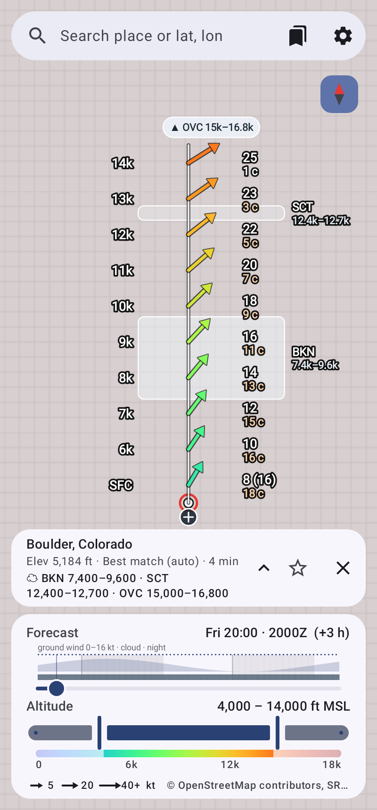
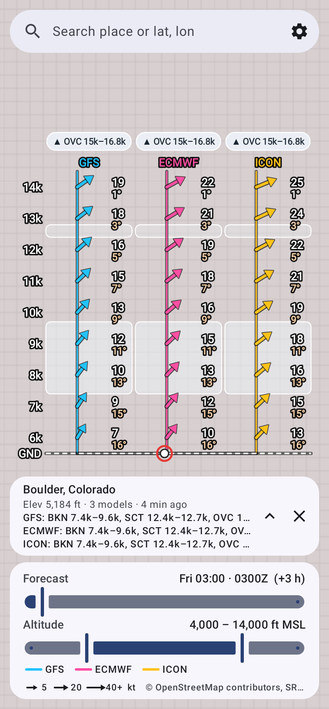
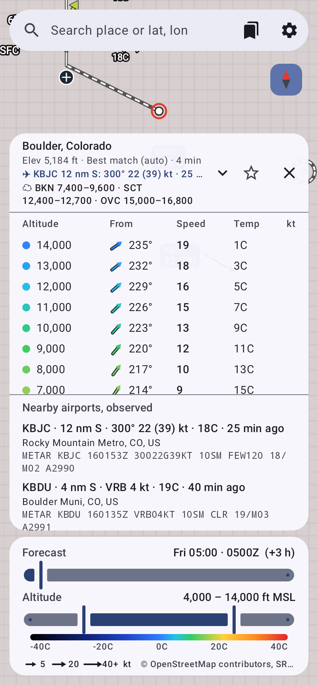
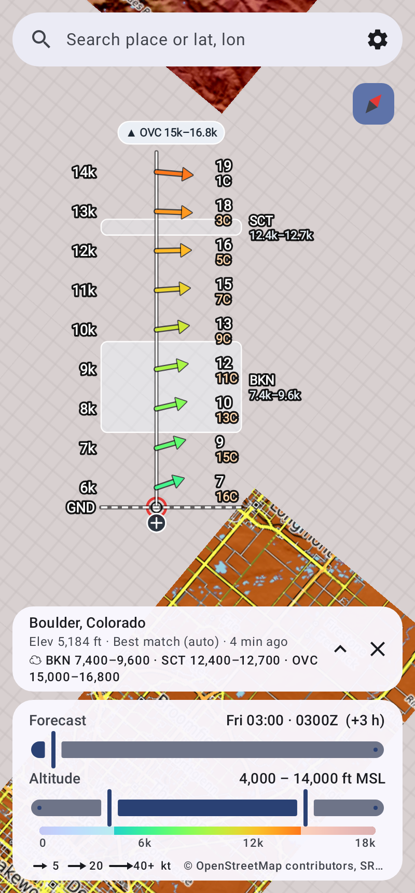
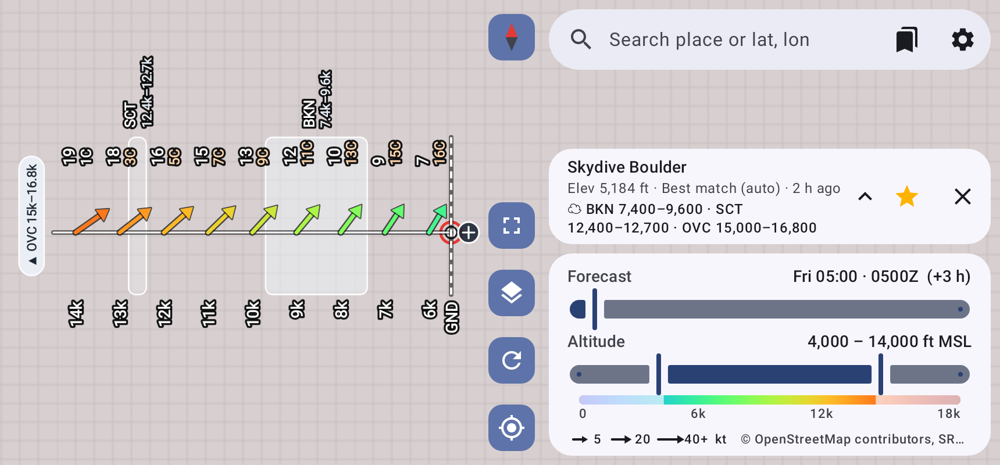

# Winds Aloft (Android)

Upper-wind forecasts drawn on a map. The pinned location gets a column of arrows rising from it, one row per 1,000 ft altitude step, lowest at the bottom. When you compare forecast models, each model gets its own column.

- **Direction**: arrows act like windsocks. Each tail sits on the column's centre line and the arrow streams **downwind** (the way the air is moving). Settings → *Wind symbol* can switch to:
  - **Triangles**, like a landing tetrahedron: they point into the wind, nose on the line.
  - **Wind barbs**, in the weather-chart convention: the station end is on the line, and the staff and feathers point into the wind.
  - *On the column line* (tail, nose or centre) overrides the symbol's default.
- **Numbers**: beside each symbol, speed on top and temperature underneath, e.g. "-3C" or "27F". The ° sign is kept for compass directions. *Numbers on the map* can also add the direction the wind comes from ("270° 19"), and each number can be turned on or off.
- **Altitude**: row position, labelled down the left side. The layout is fixed: rows have a set spacing, and each column reserves room for the longest possible arrow plus a speed/temperature slot. So nothing moves or resizes when you change the time or when panels open. Pan the map to see what's underneath, or hide all panels with one tap.
- **Colour**: altitude by default, or the model when comparing. Settings can switch it to speed, temperature, model or white, and the location table's dots and symbols use the same colours as the map. The temperature scale runs from red (40C) through yellow and green, is blue at freezing (0C / 32F), and gets darker until it reaches black at −40. Dark arrows get a light outline so they show on any map.
- **Ground**: in MSL mode, altitudes below the terrain are left out, so the column starts at the pin, which is marked **GND**.
- **Clouds**: cloud layers are drawn as bands behind the rows. Each band spans the layer's base and top to the nearest 100 ft and is shaded by coverage: SCT 25–50 %, BKN 50–87 %, OVC above that. The location panel lists them exactly, e.g. "BKN 7,400–9,600 · SCT 12,400–12,700", per model when comparing. Layers above or below the shown altitudes get a ▲/▼ marker above the column or below the pin. Layers come from Open-Meteo's per-pressure-level cloud cover, interpolated to every 100 ft.

| One model | Comparing three models |
|---|---|
|  |  |
| **Chart dragged off the pin, temperature colours** | **Map rotated 40°** |
|  |  |

Phone turned on its side (default *Along the long side*): the chart keeps running along the phone and the panels move to one side.



*These were rendered with synthetic wind data in a test. The grey background is tiles that hadn't loaded yet.*

## Features
- **Forecast-time slider**: from now out to about 72–90 h, in 1 h steps. Shows local time and Zulu time.
- **Altitude range slider**: picks which 1,000 ft levels to draw and list, from 0 up to the ceiling you set.
- **MSL or AGL** altitudes.
- **Compare up to 3 models**: one labelled, colour-coded column per model on the map. The table gives each model's direction and speed per altitude, plus **Δ**, the largest vector difference between the models (bold red at ≥ 10 kt).
- The columns size themselves to the free map area. Placing a pin moves it to the bottom-centre so the columns fit above it.
- **Arrow layout**: Stacked (default) or Fan, where all arrows share one origin and length shows speed.
- **Pinned location**: long-press the map, then confirm *Get winds here?*. A plain tap does nothing, so panning never moves the pin. You can also search for a place or type `lat, lon`. Tap the pin panel to open the full table (altitude, direction from, speed, temperature).
- **Move the chart**: drag the ⊕ handle at the bottom of the chart to put the chart anywhere on the map. The forecast spot keeps its pin, and a dashed line joins the chart to it. Drop the chart near the pin to snap it back, or use *Put the chart back on the forecast spot* in the location panel.
- **Hide panels**: the hide button switches from all panels to the forecast-time slider only. From there you can go back to all panels or hide everything; *Show panels* brings them back.
- **Map rotation**: rotate the map with two fingers. The chart stays upright, and each symbol turns so it matches its real direction on the rotated map. The compass button in the top-right corner shows which way north is; tap it to turn the map north-up again.
- **My location** button.
- **Map styles**: Topo (OpenTopoMap), Streets (OSM), Satellite (Esri World Imagery).
- **Turning the phone**: the map stays exactly where it is on the glass. The screen turns so panels, text and the keyboard are the right way up, and the map is turned back by the same amount; the compass then shows north is sideways, and tapping it makes the map north-up for the new way you're holding the phone. In landscape the panels move to a column down one side. Settings → *Chart direction* picks how the chart runs:
  - *Along the long side* (default): turned sideways, the chart keeps running along the phone toward its top edge, as if the phone were still upright, which uses the most room.
  - *Always vertical* or *Always horizontal*, whichever way the phone is held.
- **Saved places**: tap ☆ on a spot's panel to save it (favourites), and use the places button in the search bar to jump back to one. Saved places can be renamed. There is also a separate history of the last 20 spots you looked at.
- **Offline (e.g. in the plane)**:
  - The winds for every saved place and recent spot are kept on the phone, so they still show with no signal. The panel says *Offline* and how old they are.
  - Saved places are re-downloaded whenever you're online and their winds are over an hour old. *Download winds for all saved places* does it on demand.
  - "Online" means the internet is actually reachable. A plane's Wi-Fi before you've paid counts as offline, so nothing hangs waiting for it.
  - Map tiles you've viewed are kept (up to 1 GB). Offline, the map draws only saved tiles, and scales up lower-zoom tiles where it has nothing closer. Before a trip, open your drop zone and zoom around it once while online.
  - Whole areas aren't bulk-downloaded in advance. The OpenStreetMap and OpenTopoMap tile servers are run by volunteers, and their usage policies ask apps not to prefetch tiles.
- **Forecast models** (via Open-Meteo): Best match, NOAA GFS + HRRR, NOAA HRRR (US only, ~2 days), ECMWF IFS 0.25°, DWD ICON, Canada GEM, UK Met Office. Only models with upper-air data are offered; ECMWF's 9 km IFS has none. Models with sparser pressure levels, such as ECMWF, are interpolated across wider gaps.
- **Speed units**: kt, mph, km/h, m/s.

## How the winds are computed
Open-Meteo provides wind at 10/80/120/180 m above ground, and at pressure levels from 1000 to 250 hPa together with each level's geopotential height. For each hour the app:
1. Builds a vertical profile of those samples by height MSL. Pressure levels at or below the terrain are dropped.
2. Interpolates linearly to each 1,000 ft altitude, using the u/v wind *vector* so it handles direction changes across north correctly. Temperature is interpolated the same way.
3. Leaves out altitudes below ground (in MSL mode) and above the highest level.

Only the pressure levels needed for the chosen ceiling are requested, to save API quota.

## Build
Requires JDK 17+ and the Android SDK (API 36).

```bash
./gradlew assembleRelease     # app/build/outputs/apk/release/app-release.apk (debug-signed, sideloadable)
./gradlew testDebugUnitTest   # unit tests + Robolectric render of the UI
```
Or open the folder in Android Studio.

## Design playground (browser)

`playground/index.html` is a browser page for trying arrow designs side by side. It draws the app's wind columns, ported from `WindOverlay.kt`, in phone-sized frames. Each frame has its own design settings:
- layout: stacked or fan
- glyph: arrow, triangle or wind barb
- row size, arrow size and line weight
- colour: by altitude, speed or model
- labels and map fading

The forecast, altitude band and app-panel controls apply to every frame at once. **Copy design** exports a frame's settings as JSON, so a winning design can be ported back into the app.

- **Live mode:** open it from GitHub Pages or a local web server (`cd playground && python3 -m http.server`). It pulls live Open-Meteo forecasts and map tiles for any location you search or tap.
- **Snapshot mode:** when it can't reach the network, as in a claude.ai artifact, it uses `playground/snapshot.js`, a captured forecast with bundled map tiles for a few sample locations. To refresh it, run `python3 playground/tools/make_snapshot.py`. Add `--merge` to only fill in what's missing.
- **GitHub Pages:** `.github/workflows/pages.yml` publishes the playground on every push to `main` that touches `playground/`. Turn it on once under *Settings → Pages → Source: GitHub Actions*. The playground is then at `https://<user>.github.io/winds-aloft/`.

## Testing without a phone (and side by side)

**Variants install side by side.** Building with `-Pvariant=<name>` gives the app its own id and name, for example *Winds Aloft (big-arrows)*. Several experiments can then be installed next to each other and the normal app:

```bash
./gradlew assembleRelease -Pvariant=big-arrows
```

**Every branch is built automatically.** `.github/workflows/build.yml` runs on each push. It builds the branch as a variant named after the branch, runs the tests, and renders UI screenshots. Download them from the run's *Artifacts*. To try an idea: make a branch, push, then install its APK next to the others.

**Ways to run the APKs on a computer:**
- **Desktop: Android Studio's emulator** (free, Windows/macOS/Linux). Install Android Studio, open *Device Manager* and create a Pixel device (any recent API level). Start it, then **drag an APK onto the emulator window** to install it. You can start a second device to compare two variants in separate windows, or install several variants on one device.
- **Browser: [Appetize.io](https://appetize.io)**. Upload an APK and it runs in a browser tab with a shareable link. Upload each variant and open the tabs side by side. The free tier has limited minutes per month.
- **Quick visual checks: screenshots.** `./gradlew testDebugUnitTest -Dscreenshot.dir=$PWD/screenshots` renders the real UI with synthetic data, with no device at all. CI does the same for every branch.

Map tiles and live forecasts need network access in the emulator. Location can be set in the emulator's *Extended controls → Location*.

## Code map
| Path | What |
|---|---|
| `wind/WindMath.kt` | u/v maths, vertical interpolation, `ForecastPoint` |
| `data/OpenMeteo.kt` | request builder + response parser |
| `data/Network.kt` | HTTP, place search (Open-Meteo geocoding) |
| `data/Settings.kt` | settings + persistence |
| `MainViewModel.kt` | state, per-model fetching + offline cache |
| `map/WindOverlay.kt` | draws the arrow columns (or fan) on the osmdroid map |
| `ui/WindLayers.kt` | turns forecasts into per-model profiles + map columns |
| `map/MapHandle.kt` | MapView setup, tile sources, keeping the pin in view |
| `ui/` | Compose screens: search bar, sliders, profile table, settings |

## Data & attribution
- Weather: [Open-Meteo](https://open-meteo.com) (CC BY 4.0). The free tier is for non-commercial use, with about 10,000 calls a day. Each pin refresh costs about 8 calls per model.
- Maps: © OpenStreetMap contributors, © OpenTopoMap (CC-BY-SA), Imagery © Esri.

Forecasts are model output, not an official aviation product. Use them alongside official winds aloft.
