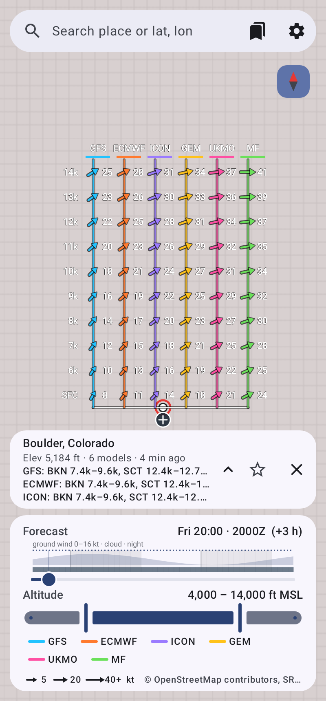
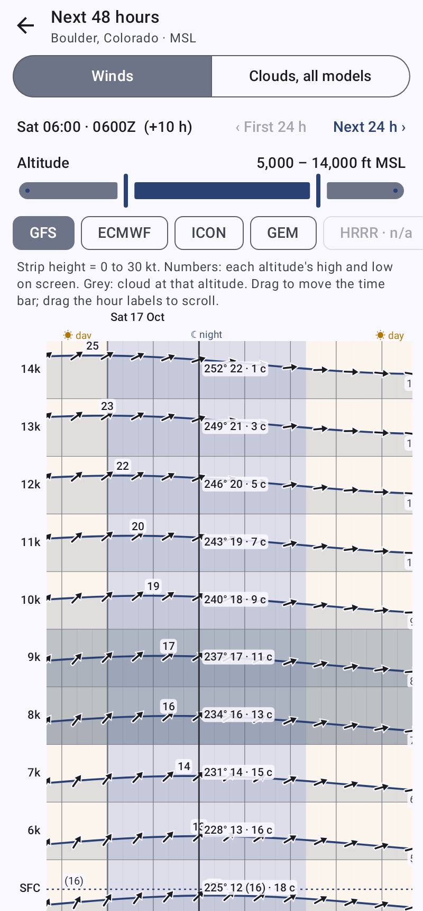
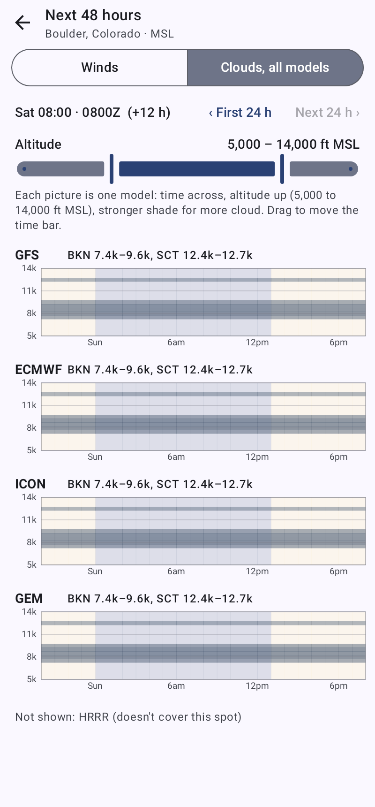
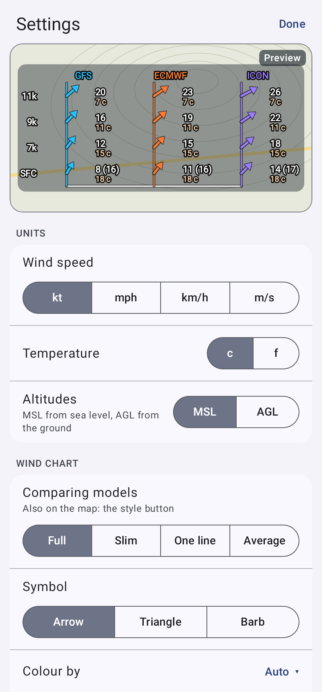

# Winds Aloft (Android)

Upper-wind forecasts drawn on a map. The pinned location gets a column of arrows rising from it, one row per 1,000 ft altitude step, lowest at the bottom. When you compare forecast models, each model gets its own column.

- **Direction**: arrows act like windsocks. Each tail sits on the column's centre line and the arrow streams **downwind** (the way the air is moving). Settings → *Symbol* can switch to:
  - **Triangles**, like a landing tetrahedron: they point into the wind, nose on the line.
  - **Wind barbs**, in the weather-chart convention: the station end is on the line, and the staff and feathers point into the wind.
  - *On the column line* (tail, nose or centre) overrides the symbol's default.
- **Numbers**: beside each symbol, speed on top and temperature underneath, e.g. "-3 c" or "27 f": a space and a small letter, because a capital C next to digits can read as a 0. The ° sign is kept for compass directions. Settings → *Numbers on the chart* can also add the direction the wind comes from ("270° 19"), and each number can be turned on or off.
- **Altitude**: row position, labelled down the left side. The layout is fixed: rows have a set spacing, and each column reserves room for the longest possible arrow plus a speed/temperature slot. So nothing moves or resizes when you change the time or when panels open. Pan the map to see what's underneath, or hide all panels with one tap.
- **Colour**: altitude by default, or the model when comparing. Settings can switch it to speed, temperature, model or white, and the location table's dots and symbols use the same colours as the map. The temperature scale runs from red (40 c) through yellow and green, is blue at freezing (0 c / 32 f), and gets darker until it reaches black at −40. Dark arrows get a light outline so they show on any map.
- **Ground wind and gusts**: the bottom row, **SFC**, is the forecast wind at ground level (10 m), with the model's gust forecast in brackets: "4 (18)" means 4 sustained, gusting 18. The same goes in the table. In MSL mode, altitudes below the terrain are left out, so the column starts with the SFC row at the pin. Forecast gusts are a model estimate for a whole grid square, so local effects such as sea breezes and terrain can make real gusts stronger.
- **Clouds**: cloud layers are drawn as bands behind the rows. Each band spans the layer's base and top to the nearest 100 ft and is shaded by coverage: SCT 25–50 %, BKN 50–87 %, OVC above that. The location panel lists them exactly, e.g. "BKN 7,400–9,600 · SCT 12,400–12,700", per model when comparing. Layers above or below the shown altitudes get a ▲/▼ marker above the column or below the pin. Layers come from Open-Meteo's per-pressure-level cloud cover, interpolated to every 100 ft.

| One model | Comparing three models |
|---|---|
|  |  |
| **Chart dragged off the pin, temperature colours** | **Map rotated 40°** |
|  |  |
| **Six models, slim columns** | **Two-day page** |
|  |  |
| **Clouds from every model** | **Settings with live preview** |
|  |  |

Phone turned on its side (default *Along the long side*): the chart keeps running along the phone and the panels move to one side.


*These were rendered with synthetic wind data in a test. The grey background is tiles that hadn't loaded yet.*

## Features
- **Forecast-time slider**: from now out to about 72–90 h, in 1 h steps. Shows local time and Zulu time. The track previews what's coming: night is shaded, a tiny graph shows the ground wind (dotted line: gusts), and a thin bar darkens where there's cloud. Tap or drag anywhere on it.
- **Two-day page** (the *48h* button): the next 48 hours on its own page, 24 hours to a screen.
  - **Moving around:** drag or tap on a chart to move the time bar. Drag the hour labels, or push the time bar past the edge, to scroll to the other day; *First 24 h* and *Next 24 h* jump. Day and night are shaded differently (☀ / ☾), in light and dark mode.
  - **Altitude range:** a slider at the top picks which altitudes the strips and cloud pictures cover. It's the same range as on the map, so changing it on one page changes both.
  - *Winds*: one strip per altitude, stacked like the map chart. The line's height is the speed, and it's drawn with arrows showing the direction. Each strip is labelled with its high and low for the hours on screen, and shaded grey where that model has cloud at that altitude. The time bar shows every altitude's direction, speed (gust) and temperature. Model chips switch between the models picked in Settings.
  - *Clouds, all models*: each selected model's cloud forecast as a small time-by-altitude picture, one under another, with the layers at the time bar beside each name. This is the quickest way to compare cloud bases across models.
- **Altitude range slider**: picks which 1,000 ft levels to draw and list, from 0 up to the ceiling you set.
- **MSL or AGL** altitudes.
- **Compare any number of models**, in four styles. The style button on the map switches between them, and so does Settings → *Comparing models*:
  - *Full*: a labelled, colour-coded column per model.
  - *Slim*: narrow columns with short arrows and speed only, so six or more fit a phone.
  - *One line*: every model's arrow from one point per altitude, with the speed range and a "Δ" badge where models differ by 10 kt or more.
  - *Average*: one average arrow per altitude, with a wedge spanning the models' directions and "average ± spread".

  Tap a model's name on the map or in the legend to show only that model; tap it again to bring the others back. The table gives each model's direction and speed per altitude, plus **Δ**, the largest vector difference between the models (bold red at ≥ 10 kt). With more than three models, the table scrolls sideways.
- **Background behind the chart**: an adjustable dark translucent panel (Settings, 0–90 %) behind the chart, so the numbers read well on a busy map.
- **Shear markers** (Settings): where the wind turns 60° or more (both winds at least 5 kt), or changes speed by 10 kt or more between neighbouring altitudes. One model gets a labelled badge ("turns 72°", "+12 kt"); several get a zigzag on each column.
- The columns size themselves to the free map area. Placing a pin moves it to the bottom-centre so the columns fit above it.
- **Arrow layout**: Stacked (default) or Fan, where all arrows share one origin and length shows speed.
- **Pinned location**: long-press the map, then confirm *Get winds here?*. A plain tap does nothing, so panning never moves the pin. You can also search for a place or type `lat, lon`. Tap the pin panel to open the full table (altitude, direction from, speed, temperature). Its ✕ only hides the panel, down to a small pill with the place and its ground wind: the spot, its chart and its forecast stay, and tapping the pill brings the panel back. To delete the spot, use *Remove this forecast spot* at the bottom of the open table.
- **Move the chart**: drag the ⊕ handle at the bottom of the chart to put the chart anywhere on the map. The forecast spot keeps its pin, and a dashed line joins the chart to it. Drop the chart near the pin to snap it back, or use *Put the chart back on the forecast spot* in the location panel.
- **Hide panels**: the hide button switches from all panels to the forecast-time slider only. From there you can go back to all panels or hide everything; *Show panels* brings them back.
- **Map rotation**: rotate the map with two fingers. The chart stays upright, and each symbol turns so it matches its real direction on the rotated map. The compass button in the top-right corner shows which way north is; tap it to turn the map north-up again.
- **My location** button: moves the map to where you are. It doesn't fetch winds; long-press the spot for that, as anywhere else.
- **Map styles** (the layers button picks one):
  - Topo (OpenTopoMap), Streets (OpenStreetMap), Outdoors (CyclOSM, with terrain and trails) and Topo (Esri).
  - Satellite (Esri World Imagery), plus *Satellite with labels* (imagery with place names and borders on top).
  - US only: **FAA VFR sectional charts** with airspace (published up to zoom 12, not for navigation), USGS topo, and USGS imagery with topo labels.
- **Turning the phone**: the map stays exactly where it is on the glass. The screen turns so panels, text and the keyboard are the right way up, and the map is turned back by the same amount; the compass then shows north is sideways, and tapping it makes the map north-up for the new way you're holding the phone. In landscape the panels move to a column down one side. Settings → *Chart direction* picks how the chart runs:
  - *Along the long side* (default): turned sideways, the chart keeps running along the phone toward its top edge, as if the phone were still upright, which uses the most room.
  - *Always vertical* or *Always horizontal*, whichever way the phone is held.
  - When the chart runs sideways, its text stays level and readable: each altitude's direction, speed, gust and temperature stack in a short block beside its symbol. The rows spread a little wider to make room.
- **Nearby airports, observed now**: the latest reports (METARs) from the airports nearest the forecast spot, from aviationweather.gov.
  - On the map, each airport gets a windsock arrow and its wind, e.g. "KSNA 22 (39)": 22 sustained, gusting 39.
  - The location panel shows the nearest airport on one line. Expanded, it lists up to four airports with distance, wind, temperature, report age and the raw METAR.
  - Reports refresh with the forecast, and on return to the app when they're over 10 minutes old. The last ones are kept for offline use.
  - Settings → *Observed winds* turns them off.
- **Settings**: one screen in six groups (Units, Wind chart, Forecast, Map & observations, Offline, How to read the chart). A live preview of the chart, drawn by the same code as the map, sits at the top and changes as you tap options. Rarely used chart options fold under *More chart options*.
- **Saved places**: tap ☆ on a spot's panel to save it (favourites), and use the places button in the search bar to jump back to one. Saved places can be renamed. There is also a separate history of the last 20 spots you looked at.
- **Offline (e.g. in the plane)**:
  - The winds for every saved place and recent spot are kept on the phone, so they still show with no signal. The panel says *Offline* and how old they are.
  - Saved places are re-downloaded whenever you're online and their winds are over an hour old. *Download winds for all saved places* does it on demand.
  - "Online" means the internet is actually reachable. A plane's Wi-Fi before you've paid counts as offline, so nothing hangs waiting for it.
  - Map tiles you've viewed are kept (up to 1 GB). Offline, the map draws only saved tiles, and scales up lower-zoom tiles where it has nothing closer. Before a trip, open your drop zone and zoom around it once while online.
  - Whole areas aren't bulk-downloaded in advance. The OpenStreetMap and OpenTopoMap tile servers are run by volunteers, and their usage policies ask apps not to prefetch tiles.
- **Forecast models** (via Open-Meteo): Best match, NOAA GFS + HRRR, NOAA HRRR (US only, ~2 days), ECMWF IFS 0.25°, DWD ICON, Canada GEM, UK Met Office, Météo-France ARPEGE + AROME, Japan JMA, China CMA GRAPES and Australia BOM ACCESS-G. Pick any number in Settings (one per line, with *Select all*).
  - Only models with upper-air data are offered; ECMWF's 9 km IFS has none. Models with sparser pressure levels, such as ECMWF, are interpolated across wider gaps.
  - A regional model that doesn't cover the pinned spot shows as "n/a here" instead of an error.
- **Speed units**: kt, mph, km/h, m/s.

## How the winds are computed
Open-Meteo provides wind at 10/80/120/180 m above ground, and at pressure levels from 1000 to 250 hPa together with each level's geopotential height. For each hour the app:
1. Builds a vertical profile of those samples by height MSL. Pressure levels at or below the terrain are dropped.
2. Interpolates linearly to each 1,000 ft altitude, using the u/v wind *vector* so it handles direction changes across north correctly. Temperature is interpolated the same way.
3. Leaves out altitudes below ground (in MSL mode) and above the highest level.

Only the pressure levels needed for the chosen ceiling are requested, to save API quota.

## Build
Requires JDK 17+ and the Android SDK (API 36).

```bash
./gradlew assembleRelease     # app/build/outputs/apk/release/app-release.apk (debug-signed, sideloadable)
./gradlew testDebugUnitTest   # unit tests + Robolectric render of the UI
```
Or open the folder in Android Studio.

## Design playground (browser)

`playground/index.html` is a browser page for trying arrow designs side by side. It draws the app's wind columns, ported from `WindOverlay.kt`, in phone-sized frames. Each frame has its own design settings:
- layout: stacked or fan
- glyph: arrow, triangle or wind barb
- row size, arrow size and line weight
- colour: by altitude, speed or model
- labels and map fading

The forecast, altitude band and app-panel controls apply to every frame at once. **Copy design** exports a frame's settings as JSON, so a winning design can be ported back into the app.

- **Live mode:** open it from GitHub Pages or a local web server (`cd playground && python3 -m http.server`). It pulls live Open-Meteo forecasts and map tiles for any location you search or tap.
- **Snapshot mode:** when it can't reach the network, as in a claude.ai artifact, it uses `playground/snapshot.js`, a captured forecast with bundled map tiles for a few sample locations. To refresh it, run `python3 playground/tools/make_snapshot.py`. Add `--merge` to only fill in what's missing.
- **GitHub Pages:** `.github/workflows/pages.yml` publishes the site on every push to `main` that touches `webapp/` or `playground/`. Turn it on once under *Settings → Pages → Source: GitHub Actions*. The web app (for iPhone) is then at `https://<user>.github.io/winds-aloft/` and the playground at `https://<user>.github.io/winds-aloft/playground/`.

## Testing without a phone (and side by side)

**Variants install side by side.** Building with `-Pvariant=<name>` gives the app its own id and name, for example *Winds Aloft (big-arrows)*. Several experiments can then be installed next to each other and the normal app:

```bash
./gradlew assembleRelease -Pvariant=big-arrows
```

**Every branch is built automatically.** `.github/workflows/build.yml` runs on each push. It builds the branch as a variant named after the branch, runs the tests, and renders UI screenshots. Download them from the run's *Artifacts*. To try an idea: make a branch, push, then install its APK next to the others.

**Ways to run the APKs on a computer:**
- **Desktop: Android Studio's emulator** (free, Windows/macOS/Linux). Install Android Studio, open *Device Manager* and create a Pixel device (any recent API level). Start it, then **drag an APK onto the emulator window** to install it. You can start a second device to compare two variants in separate windows, or install several variants on one device.
- **Browser: [Appetize.io](https://appetize.io)**. Upload an APK and it runs in a browser tab with a shareable link. Upload each variant and open the tabs side by side. The free tier has limited minutes per month.
- **Quick visual checks: screenshots.** `./gradlew testDebugUnitTest -Dscreenshot.dir=$PWD/screenshots` renders the real UI with synthetic data, with no device at all. CI does the same for every branch.

Map tiles and live forecasts need network access in the emulator. Location can be set in the emulator's *Extended controls → Location*.

## Code map
| Path | What |
|---|---|
| `wind/WindMath.kt` | u/v maths, vertical interpolation, `ForecastPoint` |
| `data/OpenMeteo.kt` | request builder + response parser |
| `data/Network.kt` | HTTP, place search (Open-Meteo geocoding) |
| `data/Settings.kt` | settings + persistence |
| `MainViewModel.kt` | state, per-model fetching + offline cache |
| `map/WindOverlay.kt` | draws the arrow columns (or fan) on the osmdroid map |
| `ui/WindLayers.kt` | turns forecasts into per-model profiles + map columns |
| `map/MapHandle.kt` | MapView setup, tile sources, keeping the pin in view |
| `ui/` | Compose screens: search bar, sliders, profile table, settings |

## Data & attribution
- Weather: [Open-Meteo](https://open-meteo.com) (CC BY 4.0). The free tier is for non-commercial use, with about 10,000 calls a day. Each pin refresh costs about 8 calls per model.
- Maps: © OpenStreetMap contributors, © OpenTopoMap (CC-BY-SA), Imagery © Esri.

Forecasts are model output, not an official aviation product. Use them alongside official winds aloft.
