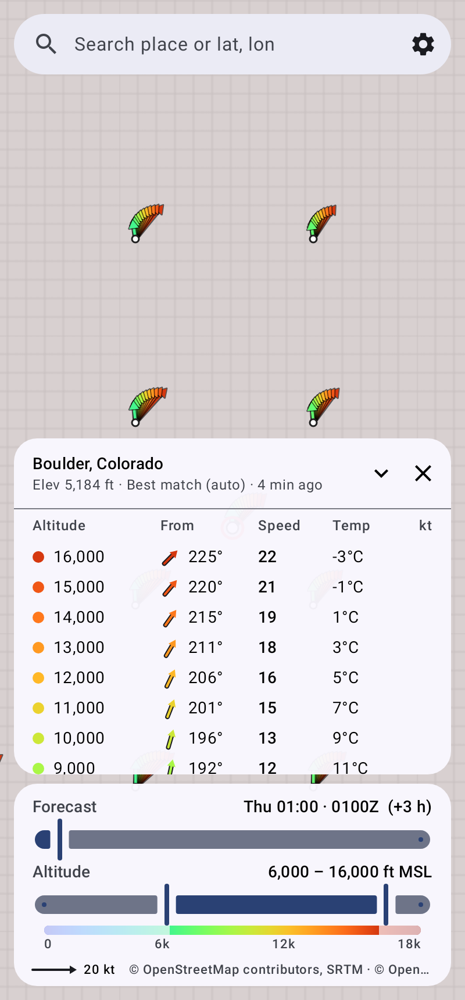

# Winds Aloft (Android)

Upper-wind forecasts drawn on a map. Each location gets a fan of arrows, one per 1,000 ft altitude step:

- **Direction**: arrows point **downwind** (the way the air is moving).
- **Speed**: arrow length is proportional to speed. The legend in the bottom card shows a 20 kt arrow.
- **Altitude**: arrow colour, from blue (low) through green and yellow to red (high). The colour bar under the altitude slider shows the scale.



## Features
- **Forecast-time slider**: from now out to about 72–90 h, in 1 h steps. Shows local time and Zulu time.
- **Altitude range slider**: picks which 1,000 ft levels to draw and list, from 0 up to the ceiling you set.
- **MSL or AGL** altitudes.
- **Arrow grid across the visible map** (3×3, 4×4 or 5×5, or off). It reloads when you pan or zoom.
- **Pinned location**: tap or long-press the map, search for a place, or type `lat, lon`. The pin gets its full profile table (altitude, direction from, speed, temperature) and a bold arrow fan.
- **My location** button.
- **Map styles**: Topo (OpenTopoMap), Streets (OSM), Satellite (Esri World Imagery).
- **Offline-friendly**: map tiles you've viewed are cached (up to 1 GB), and the last pinned forecast is saved to disk.
- **Forecast models** (via Open-Meteo): Best match, NOAA GFS + HRRR, ECMWF IFS, DWD ICON, Canada GEM.
- **Speed units**: kt, mph, km/h, m/s.

## How the winds are computed
Open-Meteo provides wind at 10/80/120/180 m above ground, and at pressure levels from 1000 to 250 hPa together with each level's geopotential height. For each hour the app:
1. Builds a vertical profile of those samples by height MSL. Pressure levels at or below the terrain are dropped.
2. Interpolates linearly to each 1,000 ft altitude, using the u/v wind *vector* so it handles direction changes across north correctly. Temperature is interpolated the same way.
3. Leaves out altitudes below ground (in MSL mode) and above the highest level.

Only the pressure levels needed for the chosen ceiling are requested, to save API quota. Grid points also skip temperature.

## Build
Requires JDK 17+ and the Android SDK (API 36).

```bash
./gradlew assembleRelease     # app/build/outputs/apk/release/app-release.apk (debug-signed, sideloadable)
./gradlew testDebugUnitTest   # unit tests + Robolectric render of the UI
```
Or open the folder in Android Studio.

## Code map
| Path | What |
|---|---|
| `wind/WindMath.kt` | u/v maths, vertical interpolation, `ForecastPoint` |
| `wind/Bbox.kt` | viewport box → grid points |
| `data/OpenMeteo.kt` | request builder + response parser |
| `data/Network.kt` | HTTP, place search (Open-Meteo geocoding) |
| `data/Settings.kt` | settings + persistence |
| `MainViewModel.kt` | state, fetching, debounced grid reloads |
| `map/WindOverlay.kt` | draws the arrow fans on the osmdroid map |
| `map/MapHandle.kt` | MapView setup, tile sources, viewport reporting |
| `ui/` | Compose screens: search bar, sliders, profile table, settings |

## Data & attribution
- Weather: [Open-Meteo](https://open-meteo.com) (CC BY 4.0). The free tier is for non-commercial use, with about 10,000 calls a day. A 4×4 grid counts as roughly 80 calls per reload.
- Maps: © OpenStreetMap contributors, © OpenTopoMap (CC-BY-SA), Imagery © Esri.

Forecasts are model output, not an official aviation product. Use them alongside official winds aloft.
